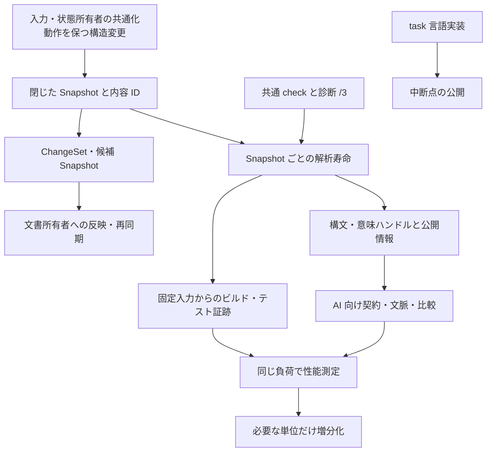

# CSP と現行 Kimigayo コンパイラーの適合調査

**調査日：** 2026年11月16日–17日

**調査基準：** `45c9fab404ceff2b62c5db097ff090e5d4019fe4`

**状態：** 一部取り込み（open）。[CSP 設計原案 v0.4](2026-11-16%20Compiler%20Server%20Protocol.md)に付属する実装調査・移行提案。SPEC・IMPL への取り込み、実装変更、性能測定は未実施。

## 1. 結論

**現在のチェックと入力管理を土台に CSP を作れる。コンパイラー全体の不変 AST 化や、増分 Parser の実装を先行させる必要はない。**

必要な中核変更は、LSP 内の入力管理を共通化すること、取得済み入力を閉じた Snapshot にすること、意味情報の寿命と公開ハンドルを整えることの三つである。型・所有権・受理の判断を CSP 用に作り直す必要はない。

一方、現行内部 Snapshot は、公開後も過去の入力を再現する CSP Snapshot ではない。構文木は編集可能で、SemanticQuery は生きた Compilation を参照する。これらをそのまま wire API に公開すると、原案の不変性・ハンドル・検証保証を満たせない。

調査はソース・既存テスト・仕様の読み取りである。以下の「存在する」はコードで確認した能力を意味し、今回の実行検証や性能保証を意味しない。ソース行番号は上記コミットを基準とする。

## 2. 入力・LSP・通信

| 項目 | 確認した実装と根拠 | 必要な変更 |
| --- | --- | --- |
| 状態所有者 | [LspSession](../../src/Kimi/Lsp/LspSession.cs) L10、[LspServer](../../src/Kimi/Lsp/LspServer.cs) L35。単一キューが文書・revision・event・結果採用を所有する。 | 現在の所有者を LSP/CSP 共通の責任へ移す。別の WorkingState や scheduler を並立させない。 |
| 未保存バッファー | LspSession L443、[WorkspaceCheck](../../src/Kimi/Lsp/WorkspaceCheck.cs) L538、[SnapshotInputSource](../../src/Kimi/Lsp/SnapshotInputSource.cs) L25。overlay がディスクより優先される。 | CSP も接続済み IDE の同じ内容所有者を使う。別 stdio プロセスが未保存内容を自動共有するとは扱わない。 |
| 編集中のテキスト | [TextDocument](../../src/Kimi/Lsp/TextDocument.cs) L9、88、136。pooled gap buffer と増分行索引、UTF-16 位置を持つ。 | この作業バッファーと公開時の不変内容を分離する。初期版で rope を追加しない。 |
| 入力の記録 | [InputStore](../../src/Kimi/Lsp/InputStore.cs) L10、24、73。File と Listing を InputKey で記録する。 | ソースだけでなくプロジェクト・lock・依存・列挙・不在・失敗を固定入力へ含める。 |
| 内部 Snapshot | InputStore L407 は辞書を複写した観測状態。[SnapshotInputSource](../../src/Kimi/Lsp/SnapshotInputSource.cs) L79、93 の CheckInputs.Read は未知の入力をディスクから取得する。 | **取得中の状態と公開済み Snapshot を分ける。** 公開後は記録済み内容・失敗だけを返す input source を同じ依存解決入口へ渡す。 |
| 入力の再確認 | WorkspaceCheck L538、580。未 mark のファイルを時刻＋サイズ、列挙をディレクトリー時刻で再利用する場合がある。 | 日常の IDE 更新の高速化として維持できるが、明示 sync と反映直前の内容同一性確認には使わない。 |
| 結果の採用 | InputStore L331 が event・revision・最初に取得した内容を確認する。 | 古い解析の採用を拒否する既存規則を保ち、Snapshot に対する結果と Current への採用を分ける。 |
| プロジェクト・依存 | [Project](../../src/Kimi/SolutionAndProject/Project.cs) L48、[DependencyResolver](../../src/Kimi/SolutionAndProject/DependencyResolver.cs) L10、57、383、396、[DependencyLock](../../src/Kimi/SolutionAndProject/DependencyLock.cs) L69。CheckInputSource が通る。 | 依存解決を再実装せず、閉じた入力 source を接続する。Product/Test の取得失敗も各 unit に分離する。 |
| 既存の修復適用 | LspSession L543、559 が版付き TextDocumentEdit をクライアントへ返す。[Units](../../src/Kimi/Lsp/Units.cs) L95 は同一文書に収まる候補だけを保持する。 | 複数文書の ChangeSet とクライアント側の部分適用結果を追加する。現在の quick fix が複数ファイルを扱えるとはみなさない。 |
| 通信 | [LspTransport](../../src/Kimi/Lsp/LspTransport.cs) L13、180、[LspCommand](../../src/Kimi/Unit/Command/LspCommand.cs) L48。framing、出力直列化、stdio がある。 | transport を共有し、CSP の dispatch と能力交換を加える。IDE 拡張側には LSP/CSP の単一接続中継が必要。 |

### 2.1 入力同一性で注意する点

[SourceContent](../../src/Kimi/Checking/CheckInputSource.cs) L57、90、113、138 は byte または text を保持する。UTF-16 の編集途中テキストはそのまま SourceDocument へ渡される一方、GetBytes は置換付き UTF-8 encoding を使う。孤立サロゲートと U+FFFD が同じ bytes になっても、コンパイラーが読む text と診断は異なり得る。現在の GetBytes にハッシュを付けるだけでは Snapshot の意味的な入力同一性にならない。

v0.4 は、取得表現の種別と正確な bytes または UTF-16 code units を識別対象にする。入力層がこの規則を所有する。GetBytes が可変 byte[] を返すため、公開済み内容を呼び出し側が変更できない所有権境界も必要である。

[HashingInputSource](../../src/Kimi/Checking/CheckDocument.cs) L69、77 にはファイル内容の SHA-256 収集があるが、入力列挙・条件・失敗・取得表現まで含む統合 Snapshot ID はまだない。

## 3. チェック・意味情報・構文

| 項目 | 確認した実装と根拠 | 必要な変更 |
| --- | --- | --- |
| 正式なチェック | [Compilation.Pipeline](../../src/Kimi/Compiler/Core/Compilation.Pipeline.cs) L129 の Check は Bind、startup、MIR 解析、記録公開、Test 発見を行う。L198 の BuildMir は checked set の収集につながる。 | Preview と CSP の check は既存の受理経路を使う。Binding 成功で終了する第二のチェックを作らない。 |
| 生成との分離 | [Compilation.Generation](../../src/Kimi/Compiler/Core/Compilation.Generation.cs) L43 の Accepts、L60 の Generate。受理判定を通して生成する。 | Emit の遅延は現在の構造に適合する。Generate が Emission partition を更新するため、同じ解析状態への問い合わせ・生成は直列化し、公開済み結果を変更しない。 |
| チェック結果の寿命 | [CheckService](../../src/Kimi/Checking/CheckService.cs) L10–14、27、88–92。Compilation は一回の Run のみで、診断と任意の切り離された HoverSnapshot を返す。 | 既存入口の内側の実行と出力確定を分離し、同じ判定経路を通常 check と Snapshot の解析所有者から使う。CSP 専有の解析状態を上限付きで保持できるようにする。 |
| 不変ソース | [SourceDocument](../../src/Kimi/Compiler/Core/SourceDocument.cs) L10、29、47–60。不変テキスト、厳密 UTF-8 decode、遅延行表がある。 | 入力・文字列を共有する初期実装に使える。BOM・元バイト列は入力層に保持する。 |
| 可変構文木 | [Koto.Ownership](../../src/Kimi/Compiler/Parsing/Koto/Koto.Ownership.cs) L39、57、112、175。Parent、SyntaxId、ReplaceChild、ReplaceAt がある。[SyntaxTable](../../src/Kimi/Compiler/Parsing/Koto/Common/SyntaxTable.cs) L4–27、79、105 はモジュール内の番号付けと編集後の再番号付けを行う。 | **異なる Snapshot の Koto を共有しない。** source-based の公開構文ハンドルと、再番号付けされる内部 ID を分ける。 |
| AST 編集の失効 | [Compilation](../../src/Kimi/Compiler/Core/Compilation.cs) L313–346 の InvalidateSourceAnalysis、NoteSyntaxEdit は解析を失効させる。DECISIONS AST1・AST2 が attachment と source provenance を定める。 | 保存済み Snapshot への AST replacement は使わない。編集対象からソース ChangeSet を生成し、新入力を再解析する。 |
| 意味読み取り | [SemanticQuery](../../src/Kimi/Compiler/Binding/SemanticQuery.cs) L3–6、15、28–40。型、Origin、symbol、call、state、failure、constraint、effect の既存契約がある。 | Binding の公開情報はこの所有者へ追加する。期待型や取得可否を構文から Adapter が再構成しない。全要件が既に公開されているとは仮定しない。 |
| 除外構文 | [Parser.Directives](../../src/Kimi/Compiler/Parsing/Parser.Directives.cs) L23、46、52 が範囲と excluding directive を保存する。L61–65 は除外された構文内容を保持しない契約。 | 既存の範囲情報だけでは全構文の安定ハンドル巡回を満たさない。Syntax 所有者に、選択されない構文も検査できる保持表現が必要。Binding 登録へ混ぜない。 |
| 診断 JSON | [CheckDocument](../../src/Kimi/Checking/CheckDocument.cs) L21–24 は単一 unit の kimi.check/2。[CheckJsonOutput](../../src/Kimi/Unit/Command/CheckJsonOutput.cs) L38、91–95 も単一入力。SPEC §23.3 は /3。 | 既存 /3 移行と同じ所有経路へ合わせる。CSP 専用の診断 schema を新設しない。cancelled request と CheckOutcome を分ける。 |

解析状態の所有者は、Snapshot と check unit の組ごとに独立した Project / Compilation を使う。CheckService は Project.KimiOptions も更新するため、Project を無条件に複数要求で共有しない。公開済み結果は不変投影とし、解析キャッシュを捨てても保持中の公開ハンドルの意味は変えない。

ハンドルの具体的な符号化、型の内部化、生成されたノードの識別は Front の実装設計事項である。まずソース構文の文書・スロット経路、意味対象の生成元と役割を用いて安定させる範囲を決め、内部 object ID を漏らさない。これを実装せずに「キャッシュを捨てても同じハンドルが使える」とは宣言できない。

## 4. 所有権・unsafe・中断点と成果物

| 項目 | 確認した実装と根拠 | 必要な変更 |
| --- | --- | --- |
| 効果・借用 | [MirEffects](../../src/Kimi/Compiler/Mir/Analysis/MirEffects.cs)、[MirBorrows](../../src/Kimi/Compiler/Mir/Analysis/MirBorrows.cs) とその concern files が判断を所有する。[HoverBuilder.Effects](../../src/Kimi/Checking/Hover/HoverBuilder.Effects.cs) L63、77 は SemanticQuery を読む例。 | MIR が位置に対応した確定事実を公開する。Hover のテキストから情報を復元せず、説明のためだけに解析を再実行しない。 |
| unsafe | [MirVocabulary](../../src/Kimi/Compiler/Mir/MirVocabulary.cs) L197、[MirBuilder.Values](../../src/Kimi/Compiler/Mir/Build/MirBuilder.Values.cs) L102–103、[MirBorrows.Storing](../../src/Kimi/Compiler/Mir/Analysis/MirBorrows.Storing.cs) L425 に unsafe scope に関わる表現・処理がある。 | 既存処理があることと、全 unsafe 義務の構造化一覧があることは別。Binding/MIR の所有者から一覧と根拠を公開する。 |
| 中断点 | [STATUS](../../docs/STATUS.md) L13 は task syntax（task; を含む）を未実装としている。今回の検索でも公開可能な中断点・task slot の実装を確認できなかった。 | CSP だけでは完結しない言語実装の依存。問い合わせは未対応を返す。中断点の空一覧で完全対応を主張しない。 |
| ビルド入力 | [CompilationBuildMetadata](../../src/Kimi/Compiler/Core/CompilationBuildMetadata.cs) L7 は complete artifact cache key ではないと明記する。[Project](../../src/Kimi/SolutionAndProject/Project.cs) L220、234 は NativeToolchain.Build に渡す。 | Snapshot 入力から準備した Project/Compilation を、再ロードせず生成・ビルドへ渡す経路を明確化する。現在の metadata だけを完全入力 ID に使わない。 |
| ネイティブ成果物 | [NativeToolchain.Build](../../src/Kimi/Build/NativeToolchain.Build.cs) L86–98 は native library を内容ハッシュ付き固定コピーへ stage。L206–212、303–311、436–440 は IR・tool・library・executable の識別を記録する。 | この既存記録へ Snapshot と検証要求を結びつける。CSP 専用の成果物台帳を重複して作らない。 |
| テスト証跡 | [TestCatalog](../../src/Kimi/Testing/TestCatalog.cs) L129、187–196 にテスト成果物の識別・manifest・executable SHA がある。 | Test unit、実際の選択ケース、設定と Snapshot を関連づける。既存の成果物照合・実行経路を使う。 |

ビルド・実行・測定に完全な hermetic sandbox は前提としない。固定ソースと成果物の関係、ツール・外部入力の識別、確認していない実行環境を記録する。タイミング測定は既存方針どおり src/Benchmark が所有する。

## 5. 変更単位と順序

以下は Major の設計単位候補であり、実装開始の指示ではない。新規表現・公開契約の担当は WORKFLOW と COMPILER_ARCHITECTURE に従う。移行凍結の例外や新しい閉じた語彙を、この提案の作成だけで承認済みとは扱わない。

| 単位 | 主担当と変更 | 完了の証拠 |
| --- | --- | --- |
| A 状態と入力の所有者 | Front。LspSession/InputStore/CheckInputSource の責任を共通化し、LSP adapter に現在状態の第二コピーを残さない。先に動作を保つ構造変更を分離する。 | 既存の入力採用・文書更新・診断・Hover の振る舞いが維持される。 |
| B Snapshot | Front と入力基盤担当。完全な取得内容・失敗・listing・条件を固定し、保持と内容 ID を実装する。 | 後のディスク更新、同時刻同サイズ変更、取得失敗、不正 UTF-16 で旧入力を取り違えない。 |
| C 正式チェックと解析寿命 | Front、受理の変更は Middle/Back と合意。既存チェックの一回限りの寿命を整理し、/3 の既存移行に接続する。 | 通常 check と受理・診断が一致し、Product/Test と複数 Snapshot が混ざらない。 |
| D 構文と意味の公開 | Front。SemanticQuery、除外構文、source-based handle。MIR の事実は Middle が公開する。 | 再解析・cache eviction 後も保持中ハンドルの意味が一致し、除外や未対応を空結果で隠さない。 |
| E 変更と反映 | Front とホスト担当。ChangeSet、prepare、IDE bridge、版付き適用、ディスク反映の限定保証、操作番号と再同期。 | Preview は無書込み。部分適用、応答喪失、古い操作番号を二重実行しない。 |
| F AI 向け契約と証跡 | Front/Middle/Back の各事実所有者。期待契約、unsafe inventory、比較、Snapshot を用いた生成・テスト。 | 根拠・範囲・未確認部分が取得でき、成果物と入力が一致する。task の未実装依存を独立に表示する。 |
| G 最適化 | 測定したボトルネックの所有者。source 共有、解析結果再利用、必要なら構文・意味の増分化。 | 全体解析との等価性と、待ち時間・割当て・保持メモリーの実測。 |

## 6. 既存テストと追加すべき観測

| 拡張する既存テスト | 追加する観測 |
| --- | --- |
| [LspInputTest](../../tests/xUnitTest/Tests/LspInputTest.cs)、[LspDocumentTest](../../tests/xUnitTest/Tests/LspDocumentTest.cs) | 取得後の外部更新、overlay、listing、失敗入力、UTF-16/UTF-8 の同一性、Snapshot 間の隔離。 |
| [LspCodeActionTest](../../tests/xUnitTest/Tests/LspCodeActionTest.cs)、[LspProtocolTest](../../tests/xUnitTest/Tests/LspProtocolTest.cs) | 複数文書の適用結果、版競合、途中失敗、操作結果忘却、再送・取消し・shutdown。 |
| [CheckServiceTest](../../tests/xUnitTest/Tests/CheckServiceTest.cs)、[CheckJsonOutputTest](../../tests/xUnitTest/Tests/CheckJsonOutputTest.cs) | Preview と正式チェックの一致、/3、Product/Test 分離、入力・生成失敗の扱い。 |
| [SyntaxEditInvalidationTest](../../tests/xUnitTest/Tests/SyntaxEditInvalidationTest.cs)、[SyntaxIdTest](../../tests/xUnitTest/Tests/SyntaxIdTest.cs)、[ExcludedSyntaxTest](../../tests/xUnitTest/Tests/ExcludedSyntaxTest.cs) | 旧 Snapshot の不変性、公開 handle と内部 ID の分離、除外構文の巡回と最内側の除外元。 |
| HoverCollectionTest / HoverProjectionTest / HoverStateTest、DiagnosticContractTest | 投影の寿命、未確定状態、事実の出所、repair の verified/required、表示量制限時の完全性。 |
| [SyntaxEditMeasurements](../../src/Benchmark/Benchmarks/SyntaxEditMeasurements.cs)、[SourceDocumentBenchmark](../../src/Benchmark/Benchmarks/SourceDocumentBenchmark.cs) | 全体解析の基準、候補比較時の待ち時間、割当て、保持メモリー。 |

新しい API の輸送契約には専用テストが必要でも、言語規則を CSP テストに重複して書かない。受理・診断・IR の判断は、既存の所有者の最も低い公開層で検査する。性能改善や全 CSP 適合は、この調査からは主張しない。

## 7. 仕様・既決事項との整合

- SPEC §23.2 の完全な受理、§23.3 の /3、§23.4 の開いた文書と LSP 無書込み、§23.5 の入力・構文・証拠を維持する。実装不足に合わせて仕様を狭めない。
- DECISIONS AST1・AST2 は既存の構文所有権と移植を所有する。本案はこの契約を破って構文木を共有しない。
- SETTLED の Hover scheduler の項目に従い、CSP のためだけに第二の scheduler や非同期 renderer を先行導入しない。応答性の変更は測定に基づく。
- COMPILER_ARCHITECTURE の target と current は区別する。新しい状態保持・公開情報・責任の移動は、実装する単位で DECISIONS と該当契約へ記録する。本調査は採用や移行ステージ完了の記録ではない。

**最初の到達点は、全体解析のままで、正確な入力を指定した問い合わせと候補比較ができること。** その後に反映と検証証跡をつなぎ、実測によって速くする。
