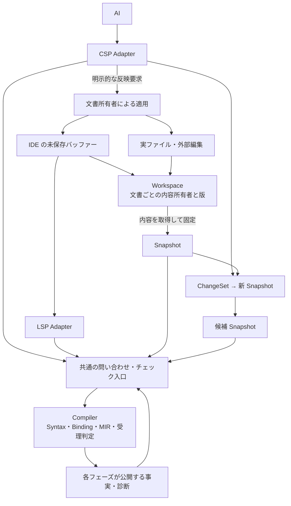
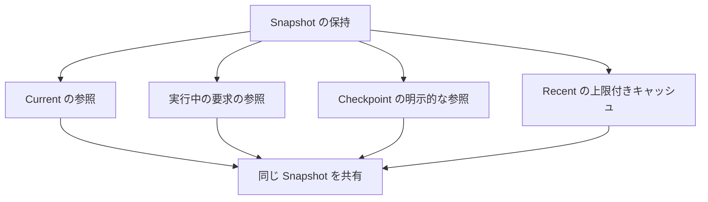
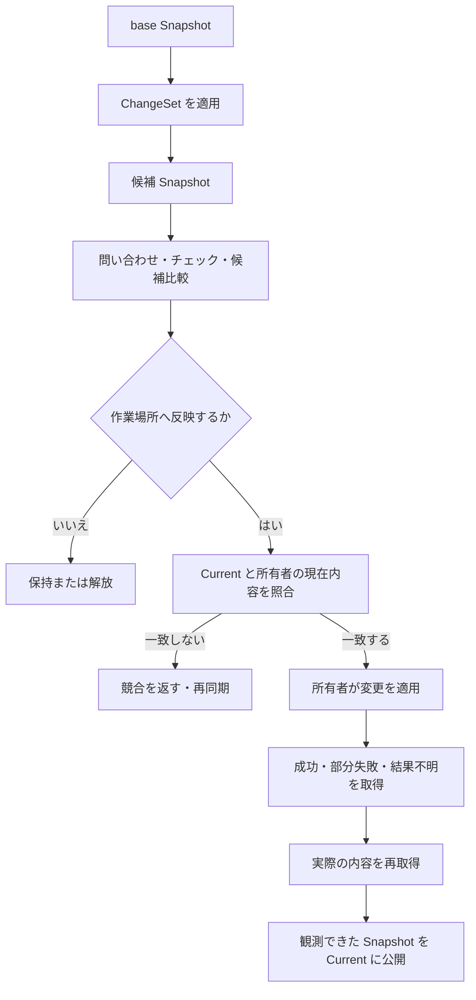
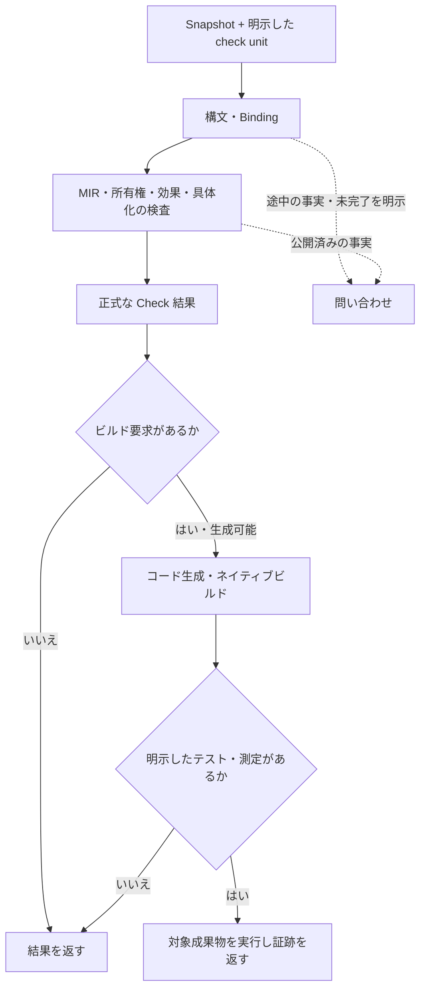
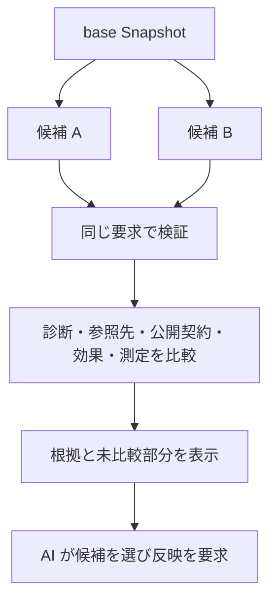
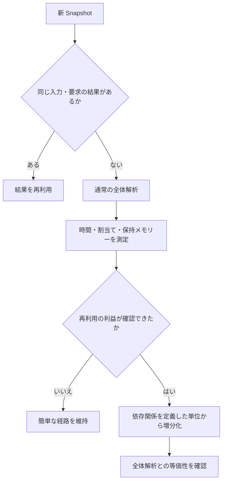

# Kimigayo CSP 設計原案

**版：** 0.4（2026年11月17日）

**状態：** 一部取り込み（open）。今回の提案から SPEC・IMPL へ取り込んだ節はなく、本文は未凍結。

**対象：** v0.3 の改訂。プロトコルと実装方針の提案であり、言語規則・現行実装の保証を変更しない。

**実装調査：** [現行コンパイラーとの適合と変更計画](2026-11-16%20CSP%20Implementation%20Assessment.md)。

> AI が、同じ入力に対して意味を調べ、変更を試し、根拠を確かめてから作業場所へ反映できるようにする。

## 1. 設計の中心

**入力を固定する。変更から新しい入力を作る。その入力に対する事実を返す。**

この一つの流れで、通常の解析、Preview、修復候補、リファクタリング、候補比較、チェック、ビルド、テストを扱う。Preview 専用の解析器や、CSP 専用の型判定は作らない。

厳密にするのは、入力の同一性、言語の判断、結果の対象と保証である。編集途中の作業場所には、不完全なコード、通知の遅れ、部分反映を許す。共有ファイルシステム全体のトランザクション、永続イベントログ、自動マージ、完全なプログラム同値性証明は要求しない。

| Principles | 設計への反映 |
| --- | --- |
| One Concept, One Canonical Form | Snapshot は一種類。変更は ChangeSet、検証は同じ入力への要求と結果。Preview・Checkpoint は別の入力表現を持たない。 |
| Local Reasoning | 各結果から入力、対象範囲、確認済みの事実、未確定部分が分かる。未取得や未対応を「存在しない」と解釈させない。 |
| Explicit Semantics | 内容の変換と作業場所への反映を分ける。型に加えて Origin、取得、Loan、効果、unsafe の義務を公開する。 |
| Compiler Server Protocol | 判断するフェーズが事実を公開し、Adapter はそれを伝える。変更とチェック・テスト・測定を正確な入力へ結びつける。 |

## 2. 全体アーキテクチャ



Workspace は文書の現在状態と同期を所有する。Compiler は固定入力だけを読む。LSP と CSP は Workspace と解析の所有者を共有し、第二の WorkingState・チェック器・スケジューラーを作らない。

接続形態は二つだけとする。単独の `kimi csp` は接続した IDE を持たないディスク作業用で、独立した `kimi lsp` の未保存内容を知っているとは扱わない。IDE 統合では拡張機能が一つのサーバープロセスと stdio 接続を所有し、LSP と CSP の要求を要求 ID が衝突しないよう中継する。AI のツール呼び出しもその拡張機能を経由する。別プロセス間で状態を自動共有しない。この中継は新規実装であり、既存の拡張機能に備わっているとは仮定しない。

`kimi lsp` は従来どおりファイルを書かず、コードを実行しない。編集は IDE が適用する。CSP の明示要求によるディスク反映・ビルド・実行は、対応するホストの責任とする。解析器にファイル書き込みやプロセス起動を持たせない。

## 3. 三つの中心概念

| 概念 | 意味 |
| --- | --- |
| Snapshot | 取得した入力集合と解析条件を固定したもの。Current と候補で同じ形式を使う。 |
| ChangeSet | 一つの base Snapshot に対する、レビュー可能なソース変更。適用すると別の Snapshot になる。 |
| 結果 | 一つの Snapshot と明示した要求に対する、事実・診断・検証証跡。確認できなかった範囲も示す。 |

Workspace、セッション、保持、通知はこれらを運用する仕組みであり、別種のプログラム状態を定義しない。

### 3.1 Snapshot の入力と同一性

Snapshot は、ソース内容、ファイル構成と列挙結果、入力の役割、プロジェクト設定、ロックファイル、解決済み依存内容、ターゲット、Debug 設定、コンパイラーの内容識別を持つ。解析が参照する入力を列挙し終えてから公開する。公開後に未知のパスをディスクから補充しない。

入力項目は内容または観測した取得失敗を持つ。存在しないファイル・列挙不能・読取不能も、パスと失敗種別を固定して再現し、成功した空ファイルにしない。依存の読込失敗で先を列挙できない場合は、その失敗が探索を止めた境界となる。Test 専用入力の失敗は Test の境界であり、Product の入力取得を止めない。後で読めるようになっても旧 Snapshot を補修せず、新 Snapshot を作る。

内容の識別は、ディスク由来なら正確なバイト列、IDE 由来なら正確な UTF-16 コードユニット列と BOM 情報を使い、表現種別も目録へ含める。孤立サロゲートを置換文字へ変換してハッシュしない。同じ表示テキストでも取得表現が違えば別の ID になってよい。不正な編集途中テキストもそのまま検査できるが、UTF-8 に損失なく変換できない内容のディスク反映は、書き込み開始前に拒否する。

`snapshotId` は、その入力目録の正規化した表現から計算する SHA-256 とする。目録の形式にも版を付ける。パス・役割・内容ハッシュ・条件を順序付きで符号化し、文字列の単純連結は使わない。目録が同じなら同じ ID になり、Current の進行順とは無関係である。v0.3 のソースだけの ID を、意味判断を決める入力全体の ID に広げるため、別の CompilationId は要らない。

パスは入力ルート内の正規相対パスとし、依存ごとにルートを識別する。ホスト上で同じファイルを指す二つのパスや大文字小文字の衝突は入力の確定時に扱い、黙って二つの文書にしない。空のディレクトリーや時刻はコンパイラー入力に含めない。ソースの改行と BOM は保持し、テキストの Unicode 正規化はしない。ソースは SPEC の UTF-8 に従い、不正なバイト列も入力として保持して所定の診断を返す。

初期実装は一セッション一プロジェクト・一ターゲット・一 Debug 設定とする。設定・依存・コンパイラーが変わったら新しいセッションを開始し、古い証拠を引き継がない。Product と Test は明示的に選択する別の check unit であり、その選択は結果に記録する。Snapshot が両方のソースを保持していても、Product のチェックは Product 入力だけを使う。Test 入力の問題を Product の不合格へ混ぜない。

Snapshot は観測した内容の集合を固定する。外部の全ファイルが同じ一瞬にその状態だったとは保証しない。更新が続いて入力を確定できないときは、同期が未完了と返す。

### 3.2 Current と保持

Current は、最後に Workspace から取り込んだ Snapshot への参照である。候補を作っただけでは切り替えない。



候補は Recent に入り、追加の保持が必要なら Checkpoint を取得する。候補専用の Snapshot 型や特別な失効規則は設けない。実行中の要求と Checkpoint が参照する入力は解放しない。上限に達した新しい保持要求は拒否し、既存の Checkpoint を黙って失わない。複数の保持要求はそれぞれの保持ハンドルを解除する。

保持する入力と、再計算できる解析キャッシュは区別する。Checkpoint は入力を残す機能であり、重い Compilation を永久に残す要求ではない。セッション終了で保持は失われる。永続保存には通常のファイルと Git を使う。

### 3.3 ハンドルと位置

構文・シンボル・型のハンドルはセッションと Snapshot に属する。構文の選択・意味情報に関わるハンドルとキャッシュは check unit も識別し、Product と Test を混同しない。同じ保持中 Snapshot のキャッシュを再構築しても、同じハンドルを別の対象へ割り当てない。初期の構文ハンドルは、文書とソース構文内の安定した位置付けから作り、Binding が振り直す内部 SyntaxId やオブジェクト参照を直接公開しない。

選択された構文と除外された構文を区別し、除外構文には最内側の除外ディレクティブを付ける。意味ノードは選択された構文について公開する。Snapshot をまたぐ同一性や、編集後の自動追跡は保証しない。古いハンドルは明示的に拒否する。

初期 wire 形式は UTF-16 のゼロ始まり offset と length を一つの基準とする。人向けの行・列は表示用に変換する。バイト列・BOM とテキスト位置の対応は SourceDocument の境界で扱う。不正 UTF-8 の入力への通常のテキスト編集は拒否し、ファイル全体の置換で修復する。

## 4. 編集と同期

### 4.1 ChangeSet の規則

ChangeSet は `baseSnapshotId` と、パスごとの変更からなる。既存文書への非重複の TextChange、内容全体を設定する PutFile、ファイル削除の三形式だけを持つ。PutFile は新規作成と既存ファイル全体の置換を同じ規則で扱い、不正 UTF-8 の修復にも使える。全 TextChange の位置は base の内容を基準とする。同位置への複数挿入は生成側が順序を決めて一つにまとめる。一つのパスに異なる形式を混在させない。TextChange は大きな文書の部分編集、PutFile は位置を前提にしない内容設定という異なる用途を持つ。

変更できるのはプロジェクトの書き込み可能なソースルートだけとし、依存ソースは読み取り専用とする。パス逸脱、別名、シンボリックリンク経由のルート外アクセスは、候補作成と実際の反映の双方で検証する。取得失敗した既存ファイルは内容照合できないため、候補として置換できても Workspace への反映は拒否する。

改名は削除と作成に展開する。Rename リファクタリングは、必要な参照の修正も含む ChangeSet を生成する。ディレクトリーはホストがファイル操作に伴って扱い、CSP のコンパイル状態として管理しない。初期版はソース編集を対象とし、設定や依存の変更はセッション再初期化として扱う。

ChangeSet の適用は、**固定入力から固定入力への変換**である。構文・型が不正になる変更も候補として作れる。範囲・パス・入力の不一致は変更要求の不正として拒否する。言語エラーの有無は、その候補をチェックして判断する。

LSP の逐次的な `didChange` は、その順序で内容を更新してから Snapshot 化する。base 基準の ChangeSet と、逐次差分の位置を混同しない。DirectEdit は既に起きた変更を観測して Snapshot 化する経路であり、架空の事前検証済み ChangeSet に変換しない。取り込み後の解析は共通である。

### 4.2 作業場所への反映

**文書ごとに内容所有者は一つ。開いた文書は IDE、その他はディスクである。** CSP のディスク反映ホストもこの所有者表を使う。未保存バッファーをディスクで上書きしない。開閉の所有権移行中は反映を止め、現在内容を再取得する。



反映要求は base と候補を指定する。セッション内の反映は一つずつ行う。base が Current と異なれば拒否する。さらに未取り込み変更を確認し、IDE の文書版またはディスクの現在内容を base と比較する。ディスク照合には内容を使い、時刻とサイズだけでは済ませない。

IDE 所有文書は版付きの WorkspaceEdit を IDE が適用する。ディスク所有文書はホストが直前照合後に適用する。複数文書の反映は原子的でなく、全体の自動 rollback はしない。失敗したら適用済み・未適用・不明のパスを返し、観測した状態へ再同期する。途中失敗を「変更なし」と返さない。

任意の外部プロセスが照合と書き込みの間に変更すると、上書きが起こり得る。初期版は OS 全体の排他を実装しない。**競合を検出して拒否する保証は協調する所有者間に限る。** 同じファイルへの非協調の同時書き込みを含めた無損失性は保証しない。ホストは利用可能な反映保証を初期化時に通知する。厳密な無損失性が必要な作業は専用 Worktree で行うか、変更案を返すところまでにする。

反映後の候補との一致、現在の観測内容、反映処理の結果は別に返す。途中で失敗して最終内容が候補と一致しても処理成功へ書き換えず、反映直後に外部変更があれば実際に観測した Snapshot を返す。再同期できなければ Current は最後の観測値のまま、同期未完了と示す。

### 4.3 通知・再試行

`changeId` はセッション内の Current 更新の通し番号であり、内容 ID と兼用しない。通知には旧・新 SnapshotId を付ける。通知が抜けたら Current を問い合わせ、必要な内容を再取得する。履歴の永久保存は要求しない。

反映要求には `operationId` を付ける。単一接続のクライアントがセッション内で単調増加する番号を採番し、サーバーは実行前に受理済みの最大番号を進める。同一 ID・同一要求の再送は、実行中または保持中の結果を返し、再実行しない。同じ保持中 ID に別の内容を付ければ拒否する。最大番号以下で結果が残っていなければ結果不明とし、新規要求として実行しない。再起動後の旧セッション ID も拒否する。結果不明なら内容を再取得して次の変更を作る。Exactly-once やクラッシュを越える復旧ログは提供しない。

キャンセルは問い合わせ・解析では結果を破棄できる。反映を始めた後は取消しを rollback と解釈せず、実施状況を確定して再同期する。

## 5. 解析と検証の共通契約

### 5.1 一つのチェック入口

Snapshot に対する正式なチェックは、同じ入力・check unit の `kimi check` または Test 準備と同じ受理判定を使う。Binding だけで合格としない。MIR の初期化・Move・借用・効果と、受理に必要な具体化の検査も含む。LLVM 出力とネイティブツールの実行は、ビルド要求まで行わない。



正式なチェック結果と診断は SPEC §23.3 の `kimi.check/3` を使う。CSP はそれに Snapshot と要求の関連を付ける。`Completed` はエラーなしを意味せず、合否は `accepted` で判断する。Product と Test の診断を混ぜない。

途中の問い合わせは、利用できる事実と、未完了・入力失敗・未対応・上限到達の理由を返す。これはチェックの `outcome` や言語の Proven / Refuted / Unknown を置き換える分類ではない。空の診断一覧、まだ作られていない意味情報、除外された構文を「合格」「存在しない」に読み替えない。

### 5.2 証跡

検証結果は SnapshotId、要求の種類・範囲・引数、使用した check unit、結果、根拠、未確認部分を記録する。テスト・測定には実際の選択ケースと入力、成果物ハッシュ、ツールチェーン、実行環境、測定条件を加える。

ビルドは固定した入力を使い、古い Snapshot を現在のディスクから再ロードしない。実行はそのビルドの成果物を指定する。外部ツールやネイティブライブラリは記録した識別と一致するものを使い、確認できなければ検証不能とする。OS・時計・外部サービスまで固定した完全再現環境は要求せず、その影響を残る不確実性として示す。

静的な判断、選択したテストの結果、特定条件の測定値は証拠の種類を区別する。測定で割当てがゼロでも、全実行についての保証にしない。unsafe の義務を列挙できても、その義務を証明したとは扱わない。

## 6. AI のための問い合わせ

### 6.1 型から、その位置で必要な契約へ

```kimi
func head<T>(values: ref/Array<T> during source) -> ref/T during source
    return values[0]
```

return の式について、期待型だけでなく、Origin の条件、利用できる宣言、取得の可否、確認済みの Loan・効果、未決の義務を問い合わせる。配列アクセスが安全か等は通常の言語規則と検査に従い、この API が成功を推測しない。

初期版は既存ノードまたは置換範囲を対象とする。新しい穴構文や任意のプログラム合成器を言語へ追加しない。不完全なコードで得られる条件が不足すれば、その不足を返す。判断の所有者が公開していない事実を Adapter が再推論しない。

### 6.2 必要な文脈を取得する

対象と取得範囲を指定すると、宣言・契約・関係する事実・根拠への参照を返す。ソース全文のコピーや巨大な AST を毎回送る必要はない。件数・深さ・出力量を制限でき、続きの参照と省略範囲を返す。必須の契約を途中で切って完全な結果に見せない。

コメントや文書中の説明はソース由来の文章として区別し、コンパイラーが確認した事実や AI への実行指示に変換しない。Hover の表示テキストを解析して機械用意味情報を作らない。

### 6.3 変更で守りたい条件を確かめる

変更後の Snapshot について、公開シグネチャ維持、unsafe の約束を増やさないこと、選択したテストの成功、指定条件の O2 メモリー割当て・実行時間などを検証対象にできる。

初期版は既存の比較・チェック・実行に対応する明示的な要求だけを受け付ける。自然言語の目的をコンパイラーが解釈する DSL や汎用証明器は作らない。要求ごとに実施範囲と結果を返し、未対応の要求を無視して全体成功にしない。未検証の希望条件は、検証済みの修復保証に混ぜない。

修復候補は既存の `verified` / `required` 条件を保持する。ChangeSet 化して候補を作り、共通のチェックで未決条件と他の独立した問題を確かめる。診断を説明するために推論をやり直したり、後処理で独立した診断を消したりしない。

### 6.4 候補比較と意味的差分



差分は比較観点を明示する。公開型が同じでも関数本体は変わり得る。IR が異なっても動作の非同値を証明したことにはならない。診断数の減少も意味の保存を保証しない。

影響範囲は、再検査の必要範囲と、観測された意味の変化を区別する。名前探索の候補集合・候補の不在・ディレクティブ・ジェネリックの具体化も依存関係に含める。完全な影響範囲を示せない初期版は、プロジェクト全体を再チェックし、影響範囲を過小に主張しない。

### 6.5 unsafe と中断点

unsafe block と依存する操作、unsafe 呼び出し、`#LibraryImport` の約束と義務を一覧にする。中断点には task slot と、その点をまたぐ Loan・所有値を付ける。各事実は Binding または MIR の所有者が公開する。

言語機能自体が未実装なら、通常の `Unsupported_Kd` を保持し、問い合わせもその範囲が未対応と返す。空一覧によって「unsafe はない」「生存する Loan はない」と主張しない。完全な CSP 適合を名乗るには、SPEC §23.5 のこれらの要求を満たす必要がある。

## 7. API と通信

初期実装は `kimi csp Project.kimiproj`、stdio、JSON-RPC とする。stdout はプロトコル専用、ログは stderr。pipe・socket・再接続用の永続履歴は実需要まで加えない。

| API 群（提案名） | 契約 |
| --- | --- |
| `kimi/initialize` | 版、セッション、能力、上限、文書所有者との接続、反映保証を通知する。 |
| `kimi/source/sync` / `kimi/snapshot/current` | Workspace の観測・同期状態と Current を得る。設定変更なら再初期化が必要と返す。 |
| `kimi/snapshot/read` / `diff` | 固定入力の内容・目録と差分を得る。 |
| `kimi/snapshot/checkpoint` / `release` | 明示的な保持参照を取得・解除する。 |
| `kimi/syntax/get` / `kimi/semantic/get` | 構文、選択状態、型、シンボル、参照、契約と根拠を指定範囲で得る。 |
| `kimi/context/get` | 編集位置の期待する契約と必要な文脈を、同じ公開事実から組み立てる。 |
| `kimi/refactor/rename` | 意味情報に基づく ChangeSet を提案する。書き込まない。 |
| `kimi/edit/prepare` | base に ChangeSet を適用し、候補 Snapshot とレビュー用差分を返す。 |
| `kimi/verify` | 指定 Snapshot に、明示したチェック・ビルド・テスト・測定・比較を実行し証跡を返す。 |
| `kimi/workspace/apply` / `operation` | 文書所有者へ反映を依頼し、実施状況と再同期結果を得る。 |

Preview は `edit/prepare` と通常の問い合わせ・検証の組合せである。`previewSnapshotId` や別の Preview エンジンは設けない。よく使う一連の操作をクライアントがまとめて提示しても、保証は各操作のままである。

解析・変更・検証は対象 Snapshot を必須とし、返答にも付ける。意味・選択構文の問い合わせとチェックには check unit も必須とする。初期化・Current 取得など対象を見つける操作は例外である。`source/changed` と要求の進行通知は、対象 Snapshot と要求を識別する。古い解析結果で新しい Current の診断を上書きしない。

Snapshot 不在、競合、不正な ChangeSet、同期未完了、保持上限、未対応能力はプロトコル上の失敗として区別する。言語診断の `Unsupported_Kd` や Internal エラーを、これらの通信エラーへ置き換えない。接続を越える永続ハンドルは提供しない。

## 8. 簡素で高速な実装

最初は全体解析を使う。不変 SourceDocument と入力バイト列を共有し、候補ごとに独立した解析状態を作る。解析結果のキャッシュは Snapshot と要求条件で管理する。Current の更新は直列化し、解析中にその入力や構文木を編集しない。



増分 Lexer・Parser、位置を持たない不変構文木、意味情報の依存追跡は独立した最適化であり、CSP の前提条件にしない。構文木の共有方式はプロトコルに漏らさない。共有できるというだけで、可変の Koto や Binding 状態を Snapshot 間で共用しない。

増分化するときは、受理、構造化診断、修復条件、問い合わせ結果が全体解析と一致することを確かめる。宣言参照だけでなく探索範囲や不在の候補にも依存する。判定できない範囲は広く再解析する。性能の判断は同じ作業負荷の待ち時間・割当て・保持メモリーで行い、ノード共有率だけを目標にしない。

## 9. 実装順序と完了条件

| 段階 | 内容 | 完了条件 |
| --- | --- | --- |
| 1 入力と結果 | 入力の固定、Current・保持、stdio、正式チェック、構造化診断 | 後からディスクが変わっても同じ Snapshot の結果は変わらない。check と受理が一致する。 |
| 2 問い合わせと候補 | 構文・意味ハンドル、公開事実、ChangeSet、Preview | 古い Snapshot を壊さず候補を比較できる。除外・未確定・未対応を区別できる。 |
| 3 反映 | 文書所有権、版照合、反映結果、再同期 | 未保存バッファーを尊重し、部分失敗と応答喪失を成功・未実行に誤分類しない。 |
| 4 AI 向け契約と証跡 | 期待契約、文脈、unsafe・中断点、固定入力からのビルド・テスト・測定 | 各結果の根拠と未確認範囲がたどれる。未実装言語機能は依存する未完了項目として残る。 |
| 5 実測による増分化 | 実際のボトルネックに限る共有・再解析削減 | 全体解析と一致し、同じ負荷で性能改善を確認する。 |

段階 1–3 は CSP の開発用部分実装であり、SPEC §23.5 全体への適合を宣言しない。段階 4 の必要な言語機能と公開情報がそろった時点で、適合を検証する。複数 AI は当面別 Worktree で分離する。候補 Snapshot は比較に使えるが、共同編集のマージ機構を含意しない。

## 10. 必ず確認するケース

| ケース | 期待する結果 |
| --- | --- |
| 過去 Snapshot の後に実ファイル・依存内容を変更 | 過去の問い合わせは固定入力を使う。未取得入力を現在ディスクから補わない。 |
| 同じ内容へ戻る | 同じ SnapshotId を使えても changeId は進む。 |
| Preview を解放、同じ Snapshot に Checkpoint がある | Checkpoint の入力は残る。解析キャッシュの再生成でハンドルの意味は変わらない。 |
| 未保存バッファーとディスクが異なる | 開いた文書の所有者の内容を解析・反映対象にする。 |
| 監視通知前の外部変更、同時刻・同サイズの変更 | 反映直前の内容照合で既存の相違を検出する。照合後の非協調競合は保証外と明示する。 |
| 複数ファイルの途中失敗、応答喪失、再起動 | 実施状況と観測状態を返す。不明な反映を自動再試行しない。 |
| Binding に問題なし、借用または具体化の検査が失敗 | 正式チェックは不合格。途中の空診断を合格にしない。 |
| Test 入力が不正、Product は正しい | 別 check unit として結果を分離する。 |
| 名前候補の追加、候補不在から存在への変化 | 全体解析と同じ解決結果・診断になる。 |
| 公開型は同じ、関数本体だけ変更 | 型の差分なしを動作の同値性にしない。 |
| 除外構文、不完全コード、未対応の task | 構文の状態・未確定部分・未対応を示す。空の意味情報で安全を主張しない。 |
| UTF-8、BOM、CRLF、非 BMP 文字、同位置挿入、改名先衝突 | 元のテキストと base 基準の位置を保ち、不正な変更を適用前に拒否する。 |

## 11. 仕様との関係

本案は SPEC §23.1–23.5 の診断・チェック・LSP・CSP、§19.4 の除外構文、§5 の unsafe、§24.1 の中断点を実現するプロトコル案である。言語の受理規則は変更しない。各段階の新しい表現・公開契約と責任の移動は、担当する Front・Middle・Back が実装単位として設計し、独立レビューと既存の移行規則に従って導入する。

原案から採用した判断は、不変 Snapshot、意味判断の一元化、事前検証、明示的保持、共通解析である。変更した判断は、入力全体の内容 ID、文書所有者による反映、Preview の通常 Snapshot 化、ディスク反映の限定保証、全体解析から始める順序である。DB 相当の永続性・全体原子性を省き、その代わりに結果不明と再同期を契約に含める。

参考： [SPEC §23](../../docs/spec/23-compiler-services.md)、[Compiler Architecture](../../docs/dev/COMPILER_ARCHITECTURE.md)、[LSP didOpen](https://raw.githubusercontent.com/microsoft/language-server-protocol/gh-pages/_specifications/lsp/3.17/textDocument/didOpen.md)、[LSP didChange](https://raw.githubusercontent.com/microsoft/language-server-protocol/gh-pages/_specifications/lsp/3.17/textDocument/didChange.md)、[Roslyn Red Green Trees](https://github.com/dotnet/roslyn/blob/main/docs/compilers/Design/Red-Green%20Trees.md)。
